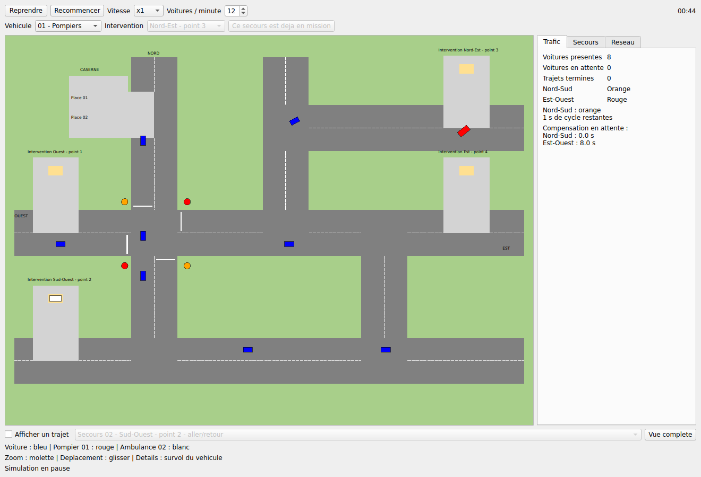

# SAE302 - Circulation, secours et coordination

Projet de **Aymeri et Selim**, BUT Reseaux & Telecommunications : une simulation de circulation a Colmar, un centre de coordination TCP et une base **MariaDB**.

L'interface utilise des formes simples et les boutons standards de Qt. Pour comprendre le code progressivement : [guide de la version simplifiee](docs/code-simple.md).

Le plan du croquis est integre directement dans `main.py` : routes grises, terrain vert, carrefour a feux a gauche, caserne au nord-ouest et quatre aires d'intervention. Les routes existantes vont jusqu'aux bords ; les aires gris clair s'arretent au bord de la chaussee. Les vehicules empruntent les routes de ce plan.



## Commencer

**Suivre le [guide de deploiement sur une VM Linux](docs/deploiement-une-vm.md).** Il explique le fonctionnement, les sockets locales, MariaDB, l'installation, PyCharm et les verifications.

Une seule VM avec bureau graphique heberge tout le projet :

| Element | Commande | Role |
|---|---|---|
| Simulation | `python main.py` | Carte et client TCP |
| Centre | `python centre.py` | Serveur TCP et affichage du suivi |
| MariaDB | Service Linux `mariadb` | Derniers etats et historique durable |

Les programmes restent separes : le client joint le centre sur **127.0.0.1:5000**, puis le centre joint MariaDB sur **127.0.0.1:3306**. Le centre ecoute en local par defaut. Les sockets fonctionnent aussi entre deux programmes d'une meme machine.

## Fonctions implementees

- Carte 2D sur fond vert, zoom, deplacement, affichage des trajets et compteurs.
- Generation de voitures depuis l'exterieur des bords visibles : 12/min par defaut, reglage de 0 a 60/min, 25 voitures au maximum. 50 % des tirages viennent du Nord. Au carrefour principal : 95 % tout droit, 2,5 % a gauche et 2,5 % a droite. Apres le feu, 5 % des trajets compatibles bifurquent vers l'Ouest sur la route du bas ou vers le Nord au milieu du plan ; les autres gardent leur parcours habituel.
- Deplacement calcule a chaque pas de simulation, arret aux feux, files et espacement minimal. Une voiture engagee finit sa traversee.
- Cycle normal 8 s de vert, 1 s d'orange, au moins 1 s de rouge simultane. Les files suivant le meme mouvement et les mouvements opposes tout droit/a droite peuvent traverser ensemble, avec un ecart minimal de 44 unites. Les mouvements qui se croisent et les secours restent exclusifs. Les voitures parcourent les courbes a 40 unites/s au lieu de 28 pour degager rapidement le carrefour.
- Devant la caserne et aux raccordements sans feux, les mouvements compatibles avancent ensemble jusqu'au vrai feu. Les voitures cedent le passage aux secours proches et repartent des que leur trajectoire est degagee. Un leader deja sorti, encore en mouvement, peut etre suivi sans attendre qu'il s'eloigne de toute la zone.
- Le raccordement Est vers la route du bas se prend uniquement depuis la gauche vers le bas. La remontee depuis le bas et le virage vers le bas depuis la droite sont interdits ; une fleche blanche indique le sens descendant.
- Choix du secours 01 ou 02 et du point Ouest (1), Sud-Ouest (2), Nord-Est (3) ou Est (4) ; trajet aller/intervention/retour, etats disponibles/occupes et estimations de duree. Chaque trajet franchit le carrefour principal a l'aller et au retour.
- Priorite verticale demandee des le depart de la caserne : la file en aval se vide, les voitures en amont laissent sortir le secours. Ailleurs, demande a 150 m ou moins **ou** 10 s d'arrivee ou moins, aller et retour compris. Au retour, le vert vertical est maintenu apres la traversee jusqu'au degagement de l'acces caserne. L'autre vert passe par 1 s d'orange et au moins 1 s de tout rouge ; les vehicules engages terminent. Arbitrage par anciennete de mission, de demande puis identifiant.
- Temps d'accumulation affiche par ligne horizontale et verticale : au-dela de 8 s de vert prioritaire, le surplus est du a l'autre ligne. Les reserves opposees s'annulent (17 s et 15 s deviennent 2 s et 0 s). Chaque prochain vert sans priorite restitue un quart du solde de sa ligne ; seul le bonus effectivement servi est deduit. Une mission loin du carrefour ne retarde plus cette restitution.
- TCP en threads, JSON delimite par lignes, numeros de mise a jour, accuses de reception, reconnexion et suivi des coupures sans changement automatique de l'etat metier.
- MariaDB : transactions, historique, rejet des doublons et des anciens numeros d'une meme session. Le centre affiche les 100 dernieres mises a jour.

## Essayer uniquement la simulation

Avec Python 3.13 et les bibliotheques graphiques Linux installees :

```bash
python3.13 -m venv .venv
source .venv/bin/activate
python -m pip install -r requirements.txt
python main.py --local
```

Cliquer sur **Demarrer**, choisir le vehicule et le point d'intervention, puis **Envoyer en intervention**. Le mode `--local` n'a besoin ni de MariaDB ni du centre, mais ne valide pas la communication.

Pour une installation complete ou un essai des deux programmes sur un seul PC, suivre le [guide](docs/deploiement-une-vm.md).

## Organisation

```text
main.py                          Application de simulation (VM unique)
centre.py                        Centre TCP, graphique ou sans fenetre (meme VM)
init_db.py                       Creation des tables MariaDB
config.example.ini               Exemple de configuration sans mot de passe
src/config.py                    Lecture de la configuration locale
src/models/layout.py             Geometrie de la carte et des trajets
src/models/vehicle.py            Vehicules et instantanes pour le dessin
src/models/route.py              Interpolation des trajets
src/simulation/engine.py         Deplacements, files, missions et temps simule
src/simulation/lights.py         Automate des feux, priorite et compensation
src/interface/                   Fenetres de simulation et de coordination
src/reseau/                      Client, serveur et protocole TCP/JSON
src/stockage/mariadb.py           Requetes SQL et transactions
sql/                             Creation des tables
tests/                           Tests metier, TCP et integration MariaDB
docs/                            Installation, architecture, utilisation et validation
```

L'ancien `src/simulation/demo.py` est conserve comme scenario historique avec ses tests. Il n'est plus utilise par l'application.

## Tests et limites

```bash
python -m unittest discover -s tests -v
```

Les tests MariaDB sont actives uniquement avec une base de test dediee : voir [validation](docs/validation.md). Les essais automatises ne remplacent pas la verification du reseau, de l'affichage et du pare-feu sur votre VM.

Le modele reste volontairement simple : mouvements en conflit reserves, espacement entre centres, allure de croisiere et allure de virage, durees estimees hors attente. La compensation conserve le solde net apres annulation des reserves opposees ; une priorite reporte tout bonus non servi. Le protocole est destine au reseau de TP, sans authentification ni chiffrement. Les messages non confirmes restent en memoire du client jusqu'a la reconnexion ; fermer ce client avant leur envoi perd cette file.

Le [cahier des charges](docs/Cahier_des_charges_SAE302.pdf) reste la reference. Le stockage MariaDB et le lancement sur une VM completent ce document a la demande du binome.

- [Utiliser les deux interfaces](docs/interface.md)
- [Comprendre le code et les changements](docs/architecture.md)
- [Tests et verification sur la VM](docs/validation.md)
